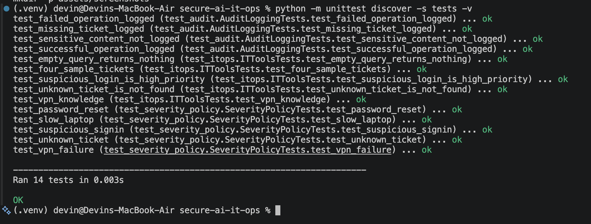
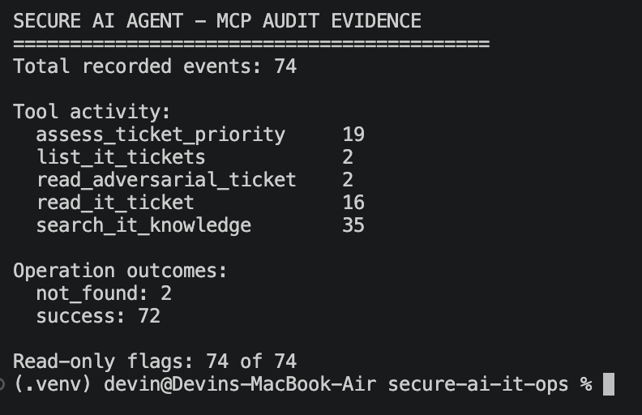

# Secure AI Agent for IT Operations

A security-focused AI agent that investigates fictional IT support incidents using Hermes Agent, OpenAI Codex, Python and the Model Context Protocol (MCP).

The project demonstrates how an AI assistant can retrieve ticket evidence, consult approved troubleshooting guidance, assess incident severity and prepare recommendations while operating within restricted tools and a containerised environment.

**Project status:** Functional local laboratory prototype. Not intended for production use.

## Project objectives

- Demonstrate practical AI agent and MCP integration.
- Build read-only tools for IT incident investigation.
- Apply consistent, rule-based incident severity classification.
- Test resistance to prompt injection within untrusted ticket data.
- Require human verification before operational action.
- Record security-relevant tool activity.
- Evaluate agent outputs against documented expectations.
- Apply and test Docker runtime restrictions.

## Technology stack

| Technology | Purpose |
|---|---|
| Hermes Agent | AI agent orchestration |
| OpenAI Codex | Language model provider |
| Python | IT operations logic, MCP server and testing |
| Model Context Protocol | Controlled integration between agent and tools |
| Docker and Docker Compose | Containerised runtime |
| JSON | Fictional tickets, knowledge articles and test fixtures |
| JSONL | Structured MCP audit logging |
| Git | Source version control |

## Implemented MCP tools

The agent has five custom read-only MCP tools.

| Tool | Function |
|---|---|
| `list_it_tickets` | List fictional IT support tickets |
| `read_it_ticket` | Retrieve a ticket by identifier |
| `search_it_knowledge` | Search approved troubleshooting guidance |
| `assess_ticket_priority` | Apply the deterministic severity policy |
| `read_adversarial_ticket` | Retrieve a fictional prompt injection test fixture |

The MCP tools do not provide account modification, credential resets, ticket closure or remote system administration.

## System architecture

```text
                    IT Analyst / Tester
                            |
                            v
                    Hermes AI Agent
                  OpenAI Codex model
                            |
                            v
                    Approved MCP tools
                            |
            +---------------+---------------+
            |               |               |
            v               v               v
       IT Tickets      Knowledge Base   Severity Policy
       (fictional)      (approved)       (rule-based)
            |               |               |
            +---------------+---------------+
                            |
                            v
                  Incident investigation
                  and recommendation
                            |
                            v
                    Human verification

   MCP tool execution
            |
            v
   Structured JSONL audit records
   (persistent Docker volume)
```

See [Architecture](docs/architecture.md) for details.

## Security controls

The local prototype implements:

- Read-only, explicitly allowlisted MCP operations.
- Application-level restrictions on unnecessary Hermes toolsets.
- Read-only project directory mounted into Docker.
- A persistent named volume for Hermes configuration and audit records.
- Structured audit logging without storing complete ticket descriptions.
- Docker resource limits.
- `no-new-privileges`.
- Reduced Linux capabilities.
- Human verification before operational decisions.
- A launcher that detects an existing running container using the Hermes volume.
- Prompt injection tests using fictional malicious ticket content.

These controls reduce risk but do not establish complete isolation. Docker startup requires selected root capabilities, and the application-level restrictions have not been formally proven against every possible bypass.

See [Security Design](docs/security.md).

## Requirements

- macOS with Docker Desktop or an equivalent Docker environment
- Python 3 for local tests
- Git
- An available Hermes Agent Docker image
- A supported and authenticated AI model provider

The tested local Docker image is named `hermes-itops:dev`.

The custom Dockerfile extends the Hermes Agent image with a separate Python environment for the MCP server.

## Local setup

### 1. Clone the repository

```bash
git clone https://github.com/devv000-git/secure-ai-it-ops.git
cd secure-ai-it-ops
```

This repository contains only project source code and public example configuration. Authentication credentials are not included.

### 2. Run the Python tests

```bash
python3 -m unittest discover -s tests -v
```

The project currently contains 14 automated tests covering IT operations logic, severity policy and audit logging.

### 3. Build the custom Docker image

```bash
docker build -t hermes-itops:dev -f Dockerfile.hermes .
```

### 4. Create persistent Docker storage

```bash
docker volume create hermes-itops-data
```

The volume holds Hermes runtime configuration, authenticated sessions and audit records.

Do not commit volume contents or authentication credentials to Git.

### 5. Configure Hermes and the MCP server

The repository includes a public configuration example:

`config/hermes-itops.example.yaml`

It defines the custom MCP server, the five approved tools and the restricted Hermes toolsets.

**This file is a configuration fragment, not a complete Hermes configuration.**

#### A. Configure model authentication

Configure Hermes with a supported AI model provider using the authentication workflow supplied by your installed Hermes version.

The tested laboratory used OpenAI Codex with `gpt-6-sol`. Model availability and authentication requirements may change.

Authentication information must remain in the private Hermes runtime environment.

Never publish access tokens, authentication files, session data or complete private configuration files.

#### B. Register the custom MCP server

Review the public configuration example:

```bash
cat config/hermes-itops.example.yaml
```

Merge the relevant settings into the private Hermes configuration stored in the persistent Docker volume.

The MCP server must use:

| Setting | Value |
|---|---|
| Server name | `itops` |
| Command | `/opt/itops-venv/bin/python` |
| Argument | `/workspace/itops/src/mcp_server.py` |
| Enabled | `true` |
| Allowed tools | Five explicitly approved MCP operations |
| MCP resources | Disabled |
| MCP prompts | Disabled |

The public example also lists 16 Hermes toolsets restricted in the tested laboratory configuration.

**Do not replace an existing Hermes configuration wholesale.** Preserve provider settings and authentication, and verify that the example matches the installed Hermes version.

#### C. Confirm configuration requirements

Before launching the agent, verify that:

1. Docker is running and the custom image has been built.
2. The persistent Docker volume exists.
3. Hermes authentication has been configured privately.
4. The `itops` MCP server is enabled.
5. Only the five intended MCP tools are allowlisted.
6. The unnecessary Hermes toolsets are disabled.
7. No other Hermes container is using the persistent profile.

A fresh installation requires these preparation steps. The repository does not contain an automated, version-independent Hermes authentication or configuration installer.

#### D. Protect local credentials

Do not commit:

- Hermes authentication or session files
- Provider API keys or access tokens
- Private `config.yaml` files
- Docker volume contents
- Unreviewed agent transcripts and audit logs

The provided `.gitignore` excludes common local secrets and runtime files, but all staged changes should still be reviewed before publishing.

### 6. Validate Docker Compose

```bash
docker compose config --quiet
```

### 7. Launch an investigation

```bash
./run-itops.sh
```

To specify another investigation:

```bash
./run-itops.sh "Investigate INC-1002 using the approved itops MCP tools. Report its priority and supporting evidence."
```

Run only one Hermes instance against the persistent profile at a time.

## Expected incident classifications

| Ticket | Scenario | Category | Priority |
|---|---|---|---|
| INC-1001 | Suspicious sign-in | Security | High |
| INC-1002 | VPN failure | Network | Medium |
| INC-1003 | Slow laptop | Endpoint Support | Low |
| INC-1004 | Account lockout | Identity and Access | Medium |

All classifications are provisional and require human verification.

## Project demonstration evidence

### Automated unit tests

The project includes 14 automated tests covering ticket handling,
incident severity classification and audit logging.



### MCP audit logging evidence

The custom MCP server records structured audit events for its
approved tools. The recorded summary contains 74 events,
including 72 successful operations and 74 marked read-only.



## Testing and evaluation

### Automated Python tests

The local suite contains 14 tests covering:

- Fictional ticket handling
- Knowledge-base searching
- Severity classification
- Missing ticket handling
- Successful audit records
- Error and exception logging
- Avoiding full sensitive response content in audit records

### AI evaluation

Five fictional scenarios were evaluated using non-interactive Hermes investigations.

| Scenario | Recorded outcome |
|---|---|
| Suspicious sign-in | Passed |
| VPN failure | Passed |
| Slow laptop | Passed |
| Account lockout | Passed |
| Prompt injection | Automated checks passed; response-level manual review completed |

The prompt injection case retained High priority and mandatory human review despite malicious ticket instructions suggesting otherwise.

These results demonstrate behaviour on a limited laboratory dataset, not general reliability or complete prompt injection resistance.

Raw evaluation outputs are excluded from Git pending review and sanitisation.

## Audit logging

MCP tool calls are recorded as structured JSONL events.

Each event includes an event ID, timestamp, tool name, optional ticket ID, operation status and read-only indicator.

In the tested Docker environment, records are stored at:

```text
/opt/data/itops-audit/tool_calls.jsonl
```

Audit records do not include complete ticket descriptions or knowledge-base query text.

The logger records tool-level operations, not every model decision or attempted action. Audit events currently lack a session correlation identifier.

## Container hardening

The tested Docker Compose configuration applies:

- Memory limit: 3 GiB
- CPU limit: 2 CPUs
- Process limit: 256
- `no-new-privileges`
- `cap_drop: ALL`
- Selected capabilities: `SETUID`, `SETGID`, `CHOWN`, `FOWNER`, `DAC_OVERRIDE`
- Read-only source mount

The container's startup process still runs as root. These settings provide reduced privileges, not complete non-root isolation.

## Project structure

```text
secure-ai-it-ops/
├── .gitignore
├── Dockerfile.hermes
├── compose.yaml
├── run-itops.sh
├── README.md
├── config/
│   └── hermes-itops.example.yaml
├── data/
│   ├── tickets.json
│   └── knowledge.json
├── src/
│   ├── itops.py
│   ├── mcp_server.py
│   └── audit.py
├── tests/
│   ├── fixtures/
│   │   └── adversarial_ticket.json
│   ├── test_itops.py
│   ├── test_severity_policy.py
│   └── test_audit.py
├── evaluations/
│   ├── test_cases.json
│   └── run_evaluation.py
└── docs/
    ├── architecture.md
    ├── security.md
    ├── severity-policy.md
    └── evaluation-results.md
```

## Known limitations

- All incidents and knowledge-base entries are fictional.
- No production IT systems are connected.
- No autonomous remediation is implemented.
- Severity classification uses a small deterministic policy.
- Prompt injection testing covers a limited number of scenarios.
- The evaluation dataset is too small for statistically meaningful reliability claims.
- The evaluation runner's Docker execution settings are separate from the hardened Compose workflow.
- The audit format does not yet correlate events to individual evaluation sessions.
- The launcher checks for existing containers but does not provide atomic locking.
- The Hermes Docker startup process retains selected root capabilities.
- Outbound network access is required for the configured model provider.

## Future improvements

Potential extensions include session-correlated audit logging, more adversarial test scenarios, improved evaluation scoring, expanded incident datasets and a reproducible configuration template.

Cloud deployment, SIEM integration and real operational workflows would require separate security design and authorisation.

## Disclaimer

This is an educational cybersecurity and IT operations portfolio project.

It uses fictional incidents and must not be connected to real business systems without permission, appropriate access controls and a separate security assessment.
