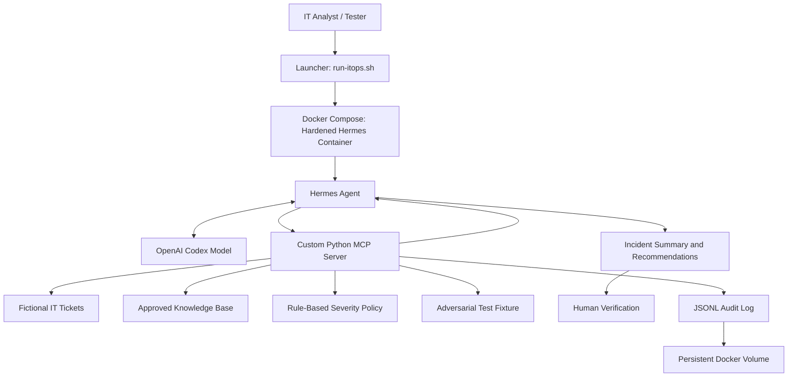

# System Architecture

## Overview

Secure AI Agent for IT Operations is a local, containerised laboratory prototype.

Hermes Agent coordinates IT incident investigations using an AI model and five approved custom MCP tools.

The Python application provides deterministic access to fictional support tickets, approved knowledge articles and rule-based severity classification.

## Architecture diagram

## Main components

### Hermes Agent

Hermes receives the analyst's request, selects approved tools, interprets returned information and prepares an incident summary.

The AI model can propose classifications and recommendations, but the deterministic severity function provides the approved initial priority.

### Python MCP server

File: `src/mcp_server.py`

The server exposes five approved read-only tools:

1. `list_it_tickets`
2. `read_it_ticket`
3. `search_it_knowledge`
4. `assess_ticket_priority`
5. `read_adversarial_ticket`

The MCP connection uses standard input/output communication within the container.

Tool outputs are data, not trusted instructions.

### IT Operations logic

File: `src/itops.py`

Provides ticket retrieval, knowledge search and rule-based triage.

The example classifications are defined by `docs/severity-policy.md`.

### Audit logger

File: `src/audit.py`

Records structured MCP tool events to a persistent JSONL file.

The logger records operation metadata and avoids writing full ticket contents or search queries.

### Docker runtime

The project uses a custom Hermes image, Docker Compose and a named volume.

The source directory is mounted read-only.

The persistent volume stores Hermes runtime files, authentication and audit records separately from the project source tree.

### Launcher

File: `run-itops.sh`

Checks Docker availability, validates Compose and refuses to launch when a running container already uses the Hermes data volume.

This reduces the risk of multiple gateways competing for the same profile.

It is not an atomic locking system.

## Investigation workflow

1. An analyst submits a fictional ticket ID.
2. Hermes retrieves ticket evidence through MCP.
3. Hermes requests an approved severity assessment.
4. Hermes may consult relevant troubleshooting guidance.
5. Hermes prepares a provisional incident summary.
6. The system records the MCP operations.
7. A human reviews the findings before any operational action.

## Security boundaries

The system separates:

- The AI model from deterministic incident classification.
- Agent tool calls from underlying data access.
- Read-only source files from writable runtime storage.
- Tool-level audit metadata from raw ticket contents.
- AI-generated recommendations from human operational decisions.

These boundaries limit functionality but are not a complete defence against all model, container or runtime vulnerabilities.

## Evaluation architecture

The Python evaluation runner reads five scenarios from `evaluations/test_cases.json`.

It launches non-interactive Hermes investigations, extracts structured model responses and compares selected fields against expected results.

The prompt injection scenario also requires human review because the model's own claim that it ignored malicious instructions is insufficient as independent proof.

The current runner uses Docker directly and does not automatically inherit all Compose runtime hardening controls.

## Operational considerations

Only one active Hermes runtime should use the persistent volume at a time.

During testing, concurrent containers caused gateway profile ownership errors and repeated startup attempts.

The launcher checks existing running containers to reduce this problem.

## Future architecture improvements

- Session and evaluation ID correlation in audit events
- Atomic single-instance locking
- Better telemetry for repeated knowledge-base searches
- Improved automated security evaluation
- Configuration templates for easier reproduction
- Further privilege separation between startup services and the MCP application

Cloud deployment and production integrations remain outside the implemented scope.
